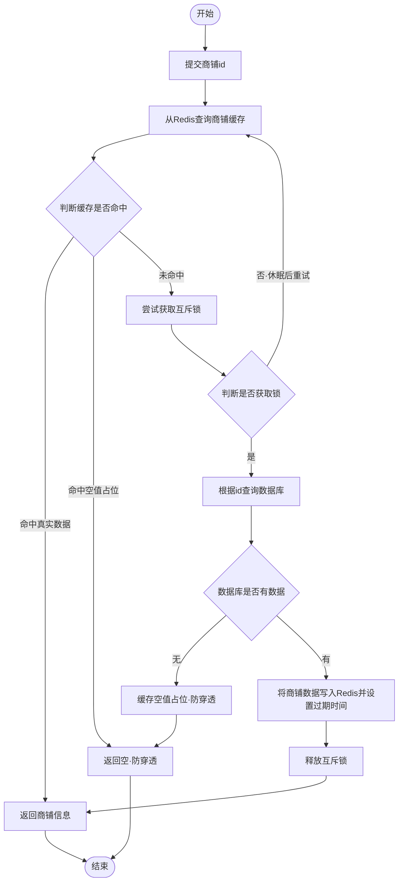
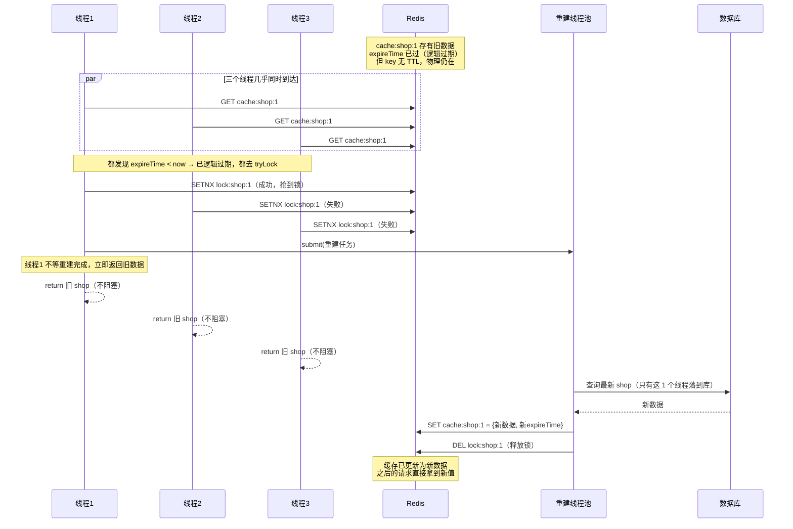
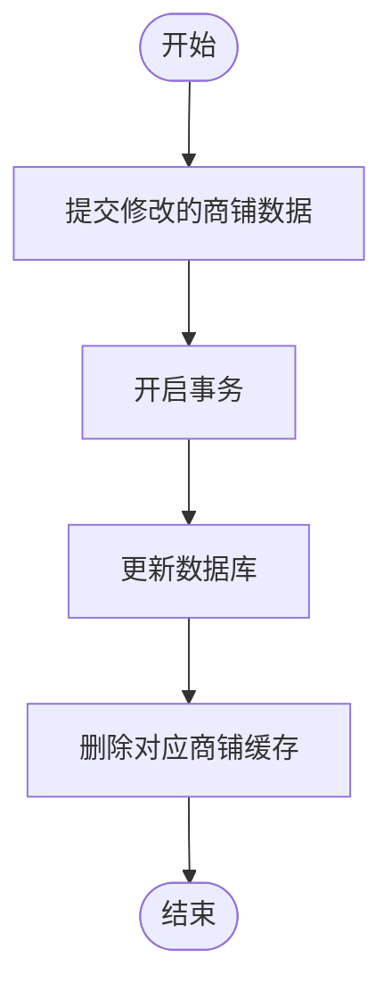

# 黑马点评 —— 商铺缓存学习笔记（业务层：问题 → 思路 → 解决办法）

> 本笔记承接第一天的登录功能，聚焦「Redis 缓存」这一章。
> 主线是**业务层 Service 的逻辑演进**：从最朴素的缓存查询出发，一步步遇到真实问题（穿透 / 击穿 / 锁的 bug），每次都用「**问题 → 思路 → 解决办法（真实代码）→ 逐行拆解**」的方式推进。
> 文中所有 `ShopServiceImpl` 代码均为**当前项目真实代码**；标注「未实现/了解」的部分是知识扩展。

---

## 一、整体架构：一次「查商铺」走了哪些业务层方法？

```
前端 shop-detail.html
    │  GET /shop/{id}
    ↓
ShopController.queryShopById(id)          ← 只做转发，不写业务
    │
    ↓
ShopServiceImpl.getById(Long id)          ← 【业务入口】校验 id + 包装 Result
    │
    ↓
ShopServiceImpl.queryWithPassThrough(id)  ← 【核心逻辑】穿透 + 击穿 + 锁 全在这
    │
    ├─ 查 Redis 命中真实数据 → 反序列化返回
    ├─ 命中空值占位("")      → 返回 null（防穿透）
    └─ 未命中 → 抢互斥锁 → 二次检查 → 查库 → 回填缓存 → 释放锁
```

**写操作（更新策略）走另一条线：**

```
前端 ──PUT /shop──→ ShopController.updateShop()
                          ↓
                    ShopServiceImpl.update(Shop shop)
                          │ ① 先更新数据库
                          │ ② 再删除缓存   ← Cache Aside
```

**涉及文件清单：**

| 文件 | 路径 | 职责 |
|------|------|------|
| [ShopController.java](../src/main/java/com/hmdp/controller/ShopController.java) | com/hmdp/controller/ | 接收 HTTP 请求，转发给 Service |
| [ShopServiceImpl.java](../src/main/java/com/hmdp/service/impl/ShopServiceImpl.java) | com/hmdp/service/impl/ | **商铺缓存核心业务逻辑**（本笔记主角） |
| [IShopService.java](../src/main/java/com/hmdp/service/IShopService.java) | com/hmdp/service/ | Service 接口（getById / update） |
| [ShopTypeServiceImpl.java](../src/main/java/com/hmdp/service/impl/ShopTypeServiceImpl.java) | com/hmdp/service/impl/ | 商铺**类型**整表缓存 |
| [RedisConstants.java](../src/main/java/com/hmdp/utils/RedisConstants.java) | com/hmdp/utils/ | 缓存 key 前缀、TTL、锁 key 常量 |
| [RedisData.java](../src/main/java/com/hmdp/utils/RedisData.java) | com/hmdp/utils/ | 「逻辑过期」方案的数据载体（本项目未启用） |
| [Shop.java](../src/main/java/com/hmdp/entity/Shop.java) | com/hmdp/entity/ | 商铺实体 |

> 📌 **两种缓存粒度**（项目都出现了）：
> - **单条缓存**：`cache:shop:{id}` —— 每个商铺一个 key，见 `ShopServiceImpl`
> - **整表缓存**：`cache:shop:type:` —— 固定 key 存整个列表 JSON，见 `ShopTypeServiceImpl`

> 📊 完整业务流程图已放在对应业务代码正上方：查询见 4.3、更新见 8.3（先看流程图懂逻辑，再看代码）。

---

## 二、业务层职责分离：getById 只做「入口」，queryWithPassThrough 做「逻辑」

### 2.1 问题
一开始所有逻辑都堆在 `getById` 里：既要查缓存、又要查库、又要处理穿透击穿。方法越来越长，`Result` 的包装和缓存逻辑搅在一起，难读难改。

### 2.2 思路
**分层拆方法**：
- `getById(Long id)`：业务入口，只负责「校验参数 + 调用核心方法 + 包装成 `Result`」
- `queryWithPassThrough(Long id)`：私有核心方法，只负责「缓存 + 穿透 + 击穿」，返回 `Shop` 或 `null`，不碰 `Result`

### 2.3 解决办法（真实代码）

> 📁 源码：[ShopServiceImpl.java](../src/main/java/com/hmdp/service/impl/ShopServiceImpl.java)

```java
@Override
public Result getById(Long id) {
    //校验店铺id，与 update 保持一致：id 为空直接拒绝，避免拼出 cache:shop:null 这类无效 key
    if (id == null) {
        return Result.fail("店铺id不能为空");
    }
    Shop shop = queryWithPassThrough(id);
    //判断店铺信息是否存在
    if (shop == null) {
        return Result.fail("店铺信息不存在");
    }
    return Result.ok(shop);
}
```

### 2.4 逐行拆解

| 代码 | 作用 / 为什么 |
|------|--------------|
| `if (id == null)` | **参数校验前置**。id 为空若直接拼 key 会得到 `cache:shop:null`、`lock:shop:null` 这种脏 key，还可能 NPE。和 `update()` 里的 id 判空保持同一套规矩 |
| `queryWithPassThrough(id)` | 调核心方法拿 `Shop`。核心方法**不返回 Result**，职责单一 |
| `if (shop == null)` | 核心方法用 `null` 表达「查不到」（无论是空值缓存命中还是库里真没有）。入口在这里统一翻译成 `Result.fail` |
| `Result.ok(shop)` | 查到就包装成统一响应 |

> 💡 **为什么核心方法用 `null` 而不是 `Result`？** 因为它是「查数据」的纯逻辑，不该关心 HTTP 响应格式。返回 `Shop`/`null` 让它可复用、可单测；`Result` 是表现层的事，留给入口方法。

---

## 三、缓存穿透：查一个「根本不存在」的数据

### 3.1 问题
朴素缓存里，数据不存在（如恶意查 `id = -1`）时只是 `return fail`，**没往缓存写任何东西**。于是同样的非法请求每次都绕过缓存直达数据库：

```
黑客 ──GET /shop/-1──→ 缓存没有（从没写过）→ 数据库也没有 → 返回失败
        ↓ 再发 10000 次，每次都穿透到数据库 → 数据库被压垮
```

### 3.2 思路
数据库查不到时，**主动往 Redis 缓存一个空值占位（`""`）**，并设**较短 TTL**。下次同样的非法 id 直接被缓存拦下，不再打到数据库。
项目常量 `CACHE_NULL_TTL = 2L` 就是为这个空值准备的。

### 3.3 解决办法（真实代码，摘自 queryWithPassThrough）

> 📁 源码：[ShopServiceImpl.java](../src/main/java/com/hmdp/service/impl/ShopServiceImpl.java)

```java
//1.查询redis缓存中是否存在
String shopjson = stringRedisTemplate.opsForValue().get(CACHE_SHOP_KEY + id);
//2.判断redis缓存中是否存在
if (StrUtil.isNotBlank(shopjson)) {
    //3.存在，直接返回
    return JSONUtil.toBean(shopjson, Shop.class);
}
//3.1命中的是空值缓存（存的是""），说明该店铺不存在，直接拦截，防止穿透
if (shopjson != null) {
    return null;
}
```

以及后面查库为空时写入占位（在锁内）：

```java
//6.1查询数据库
shop = getById((Serializable) id);
if (shop == null) {
    //6.2数据库中不存在，缓存空值，防止穿透
    stringRedisTemplate.opsForValue().set(CACHE_SHOP_KEY + id, "", CACHE_NULL_TTL, TimeUnit.MINUTES);
    return null;
}
```

### 3.4 逐行拆解（关键在「三种状态」的区分）

`stringRedisTemplate.get(key)` 的返回值有**三种含义**，判断顺序必须精确：

| 返回值 | 含义 | 处理 |
|--------|------|------|
| 有内容的 JSON | 缓存命中真实数据 | `isNotBlank` 成立 → 反序列化返回 |
| `""` 空字符串 | **我们特意缓存的空值占位** | `isNotBlank` 不成立、但 `!= null` 成立 → 返回 `null`（拦截） |
| `null` | 缓存里根本没这个 key | 两个 if 都不成立 → 往下走去抢锁查库 |

- `StrUtil.isNotBlank(shopjson)`：Hutool 工具，`null` 和 `""` 都返回 false
- `if (shopjson != null)`：这一步专门捕捉「空串占位」——它是防穿透的核心闸门
- 空值用 `CACHE_NULL_TTL`（2分钟）而非正常 `CACHE_SHOP_TTL`（30分钟）：空值只是临时挡箭牌，短一点，万一这个 id 后来真有数据了，也能较快恢复

### 3.5 另一种思路：布隆过滤器（了解，本项目未用）
在缓存前加一层布隆过滤器存所有合法 id，非法 id 直接拒。优点省内存，缺点有误判、不支持删除（Redisson `RBloomFilter`）。

---

## 四、缓存击穿：某个「热点 key」突然失效

### 4.1 问题
穿透是「查不存在的」，击穿是「**查存在的、但缓存刚好过期的热点数据**」：

```
爆款商铺 id=1，平时 99% 命中缓存
   ↓ 缓存 TTL 到期的那一瞬间，key 消失
   ↓ 同时涌入 10000 个查 id=1 的请求
   ↓ 全部发现缓存没了 → 全部冲向数据库重建 → 数据库被打爆
```

### 4.2 思路
**互斥锁**：同一时刻**只让一个线程去查库重建缓存**，其余线程等一会儿再来看缓存。
项目常量 `LOCK_SHOP_KEY = "lock:shop:"`、`LOCK_SHOP_TTL = 10L` 就是为此准备的。

### 4.3 解决办法（真实代码，完整 queryWithPassThrough）

> 📁 源码：[ShopServiceImpl.java](../src/main/java/com/hmdp/service/impl/ShopServiceImpl.java)

**业务流程图（先看逻辑，再看代码）：**



```java
private Shop queryWithPassThrough(Long id) {
    //1.查询redis缓存中是否存在
    String shopjson = stringRedisTemplate.opsForValue().get(CACHE_SHOP_KEY + id);
    //2.判断redis缓存中是否存在
    if (StrUtil.isNotBlank(shopjson)) {
        //3.存在，直接返回
        return JSONUtil.toBean(shopjson, Shop.class);
    }
    //3.1命中的是空值缓存（存的是""），说明该店铺不存在，直接拦截，防止穿透
    if (shopjson != null) {
        return null;
    }
    //4.缓存未命中，尝试获取互斥锁
    String lockKey = LOCK_SHOP_KEY + id;
    Shop shop = null;
    String token = null;
    try {
        token = tryLock(lockKey);
        //5.获取锁失败，休眠后重试（递归查询）；此时并未持有锁，绝不能释放别人的锁
        if (token == null) {
            Thread.sleep(100); // 休眠100毫秒
            return queryWithPassThrough(id);
        }
        //6.获取锁成功，只有在持锁期间才需要在 finally 里释放
        try {
            //6.0重建缓存前先二次检查缓存是否已被别人写好
            shopjson = stringRedisTemplate.opsForValue().get(CACHE_SHOP_KEY + id);
            if (StrUtil.isNotBlank(shopjson)) {
                return JSONUtil.toBean(shopjson, Shop.class);
            }
            //6.1查询数据库
            shop = getById((Serializable) id);
            if (shop == null) {
                //6.2数据库中不存在，缓存空值，防止穿透
                stringRedisTemplate.opsForValue().set(CACHE_SHOP_KEY + id, "", CACHE_NULL_TTL, TimeUnit.MINUTES);
                return null;
            }
            //6.3数据库中存在,写入redis缓存
            stringRedisTemplate.opsForValue().set(CACHE_SHOP_KEY + id, JSONUtil.toJsonStr(shop), CACHE_SHOP_TTL, TimeUnit.MINUTES);
        } finally {
            //7.释放锁（只有抢到锁的线程才会走到这里，且只删自己持有的锁）
            unlock(lockKey, token);
        }
    } catch (InterruptedException e) {
        throw new RuntimeException(e);
    }
    return shop;
}
```

### 4.4 逐行拆解（业务逻辑流）

| 步骤 | 代码 | 逻辑意图 |
|------|------|---------|
| ①②③ | 查缓存 → `isNotBlank` 命中返回 | Cache Aside 读路径，命中就不碰锁、不碰库 |
| ③.1 | `shopjson != null` 返回 null | 命中空值占位，防穿透（见第三章） |
| ④ | `tryLock(lockKey)` 返回 token | 抢锁。抢到返回唯一 token，抢不到返回 null |
| ⑤ | `token == null` → sleep + 递归重试 | **没抢到锁**：说明别的线程正在重建，等 100ms 再从头走一遍（大概率下次缓存已就绪，直接命中①返回） |
| ⑥.0 | 抢到锁后**再查一次缓存** | **double check**：排队期间可能别人已把缓存写好了，避免重复查库 |
| ⑥.1⑥.2 | 查库；库里没有就缓存空值 | 空值同样在锁内写，保证防穿透 |
| ⑥.3 | 查库有值 → 回填缓存（30分钟） | 重建缓存，后续请求命中① |
| ⑦ | `finally { unlock(lockKey, token) }` | 释放锁，且**只删自己的** |

> ⚠️ **递归陷阱**：`getById((Serializable) id)` 必须加 `(Serializable)` 强转。本类有 `getById(Long)`，父类 `ServiceImpl` 有 `getById(Serializable)`（真正查库）。不强转 → 编译器选中本类的 `getById(Long)` → **自己调自己，无限递归 StackOverflow**，而且返回类型 `Result` 也赋不进 `Shop`（会直接编译报错）。

---

## 五、击穿实现里踩过的两个坑（重点：从 bug 到修复）

> 这一节是本项目**真实调试经历**，也是手写分布式锁最容易错的地方。

### 坑 1：抢锁失败的线程「误删了别人的锁」

**问题代码（早期版本）：**
```java
try {
    boolean isLocked = tryLock(lockKey);
    if (!isLocked) {
        Thread.sleep(100);
        return queryWithPassThrough(id);   // ← return 前会先执行下面的 finally！
    }
    ... 查库重建 ...
} finally {
    unlock(lockKey);   // ← 没抢到锁的线程也会走到这，删掉了别人正持有的锁
}
```
**后果**：抢锁失败的线程根本没持有锁，却在 `finally` 里 `delete` 了别人正在用的锁 → 击穿保护失效，多个线程同时冲进数据库。

**思路**：释放锁的动作，必须**只发生在「确实抢到锁」之后**。

**解决办法：嵌套 try-finally**（当前代码）
```java
try {
    token = tryLock(lockKey);
    if (token == null) {
        Thread.sleep(100);
        return queryWithPassThrough(id);   // ← 这里 return，走的是【外层】的 catch，不碰内层 finally
    }
    try {
        ... 持锁期间的查库重建逻辑 ...
    } finally {
        unlock(lockKey, token);   // ← 内层 finally：只有拿到锁才会进来，才释放
    }
} catch (InterruptedException e) {
    throw new RuntimeException(e);
}
```
- **内层** `try-finally`：只包住「持锁后」的逻辑，保证 `unlock` 与「成功加锁」严格配对
- **外层** `try-catch`：负责接住重试分支里 `Thread.sleep` 抛的 `InterruptedException`

### 坑 2：锁没有「归属标识」，超时后删掉了别人的锁

**问题**：早期 `tryLock` 把锁 value 写死成 `"1"`，`unlock` 无条件 `delete`。
**事故时序**：
```
线程A 抢到锁 → 查库很慢（>10秒）→ 锁 TTL 到期自动过期
线程B setIfAbsent 成功 → B 拿到"新锁"开始重建
线程A 终于查完 → finally unlock → delete 掉的是 B 的锁！
线程C 又能立刻抢锁 → 击穿保护再次失效，连锁反应
```

**思路**：加锁时给锁一个**唯一标识（token）**，解锁时先比对「这把锁还是不是我的」，是才删。

**解决办法（当前代码）：**
```java
private String tryLock(String key) {
    //锁的 value 存唯一标识，解锁时比对归属，防止删掉别人持有的锁
    String token = UUID.randomUUID().toString();
    Boolean flag = stringRedisTemplate.opsForValue().setIfAbsent(key, token, LOCK_SHOP_TTL, TimeUnit.SECONDS);
    return BooleanUtil.isTrue(flag) ? token : null;   // 抢到返回 token，没抢到返回 null
}
private void unlock(String key, String token) {
    String value = stringRedisTemplate.opsForValue().get(key);
    //是自己的锁才删；若锁已超时自动过期并被别人重新持有，则不能动
    if (value != null && value.equals(token)) {
        stringRedisTemplate.delete(key);
    }
}
```
- `setIfAbsent(key, token, ttl)` = Redis `SET NX EX`，**一条命令原子完成**「不存在才设置 + 设过期」，避免「先 setnx 再 expire、中间宕机导致锁永不过期」的死锁坑
- `UUID` 用的是项目统一的 `cn.hutool.core.lang.UUID`（和登录 token 同款）
- 现在坑 2 的时序变成：A 回来 `get` 到的 value 是 **B 的 token** ≠ A 的 token → **A 不动 B 的锁** ✅

### 仍存在的两个局限（诚实记录，未改）

| 局限 | 说明 | 生产级做法 |
|------|------|-----------|
| `get` 比对 + `delete` 两步**非原子** | 极端情况下比对完、删除前的微秒间隙锁刚好过期又被别人拿到，仍可能误删 | 用 **Lua 脚本**把「比对+删除」合成原子操作，或直接上 **Redisson** |
| 抢锁失败用**递归**重试 | 重建耗时长时递归层数累积，理论上有 **StackOverflowError** 风险 | 改成 **while 循环**自旋重试，栈帧不增长 |

> 结论：手写锁能覆盖学习/中小场景，但「归属校验 + 原子释放 + 自动续期（看门狗）」才是完整方案，生产环境推荐 Redisson 可重入锁。

---

## 六、缓存击穿方案二：逻辑过期（本项目未启用，了解）

> `RedisData` 类已存在但当前 `ShopServiceImpl` **没有使用**，这里作为对比方案学习。

### 6.1 思路
**不给 key 设 Redis TTL**（key 永不过期），而是在 value 里存一个「**逻辑过期时间**」字段。发现逻辑过期后，**开一个独立线程异步重建**，当前请求**先返回旧数据**，不阻塞用户。

`RedisData`（真实代码，[RedisData.java](../src/main/java/com/hmdp/utils/RedisData.java)）：
```java
@Data
public class RedisData {
    private LocalDateTime expireTime;   // 逻辑过期时间（不是 Redis TTL！）
    private Object data;                // 真正的业务数据（如 Shop）
}
```

#### 线程 1 / 2 / 3 并发时序图（逻辑过期的核心）

> 场景：`cache:shop:1` 里的数据**逻辑上已过期**（expireTime 已过），但 key **没有物理 TTL、不会消失**。此刻线程 1、2、3 几乎同时来查。



#### 跟着图走一遍（步骤版）

| 时刻 | 线程1 | 线程2 | 线程3 | 数据库 |
|------|-------|-------|-------|--------|
| ① 都读到 key | 拿到旧数据+发现过期 | 同左 | 同左 | — |
| ② 都去抢锁 | **抢到** | 抢不到 | 抢不到 | — |
| ③ 抢到锁的提交异步重建 | 丢任务给线程池 | — | — | — |
| ④ 当前请求立即返回 | 返回**旧**数据 | 返回**旧**数据 | 返回**旧**数据 | — |
| ⑤ 后台线程重建 | （已返回） | （已返回） | （已返回） | **只有 1 次查询** |
| ⑥ 重建完成 | — | — | — | 写回新数据+新过期时间 |

**三个关键结论：**
1. **不阻塞**：三个线程都**立刻**拿到旧数据返回，没有任何 `sleep`/等待 → 高并发下响应极快（这是与互斥锁最大的区别）。
2. **不击穿**：无论多少线程同时命中过期 key，**只有抢到锁的那 1 个**会提交重建任务去查库 → 数据库只收到 1 次请求。
3. **代价是短暂不一致**：重建完成前，所有线程读到的都是**旧数据**；重建写回后，后续请求才拿到新值。

> ⚠️ **前提：必须预热**。因为 key 不设 TTL，若某个 key 从没进过缓存（`GET` 返回空），逻辑过期方案会直接返回 null（图里没画这个分支）。所以该方案要求**上线前先把热点数据手动写入缓存**（带一个初始 expireTime），不适合“冷 key”。

> 🔗 **对比互斥锁（第五章）**：同样是线程 2、3 抢锁失败——互斥锁会 `sleep+重试`，**等**线程 1 重建完拿到**新**数据（一致但慢）；逻辑过期则**不等**，直接拿**旧**数据返回（快但不一致）。选型就看你优先“一致性”还是“可用性/性能”。

### 6.2 示意实现（示例，非项目代码）
```java
private Shop queryWithLogicalExpire(Long id) {
    String json = stringRedisTemplate.opsForValue().get(CACHE_SHOP_KEY + id);
    if (StrUtil.isBlank(json)) {
        return null;                       // 未命中（该方案要求热点 key 提前预热进缓存）
    }
    RedisData redisData = JSONUtil.toBean(json, RedisData.class);
    Shop shop = JSONUtil.toBean((JSONObject) redisData.getData(), Shop.class);
    // 逻辑时间未过期 → 直接返回
    if (redisData.getExpireTime().isAfter(LocalDateTime.now())) {
        return shop;
    }
    // 逻辑已过期 → 抢锁的线程开新线程异步重建，当前请求先返回旧数据
    String lockKey = LOCK_SHOP_KEY + id;
    if (tryLock(lockKey) != null) {
        CACHE_REBUILD_EXECUTOR.submit(() -> {
            try { saveShop2Redis(id, 20L); }
            finally { unlock(lockKey, token); }
        });
    }
    return shop;
}
```

### 6.3 两种击穿方案对比

| 方案 | 一致性 | 性能 | 实现难度 | 适用场景 | 本项目 |
|------|--------|------|---------|---------|--------|
| 互斥锁 | ✅ 高 | ❌ 较低（要等待/自旋） | 中 | 一致性要求高（库存、金额） | ✅ 已采用 |
| 逻辑过期 | ❌ 低（返回旧数据） | ✅ 高（不阻塞） | 高（要预热+线程池） | 性能优先（秒杀页、首页推荐） | ❌ 未启用 |

---

## 七、缓存雪崩：大量 key「同时」失效（当前真实风险，未修）

### 7.1 问题
击穿是「一个热点 key」，雪崩是「**一大批 key 同一时刻集体过期**」或 **Redis 宕机**：
```
一次性缓存 10000 个商铺，都设「30分钟后过期」
   ↓ 30分钟后集体失效 → 所有请求同时打库 → 数据库崩
```

> ⚠️ **本项目现状**：`ShopServiceImpl` 和 `ShopTypeServiceImpl` 写缓存用的都是**固定** `CACHE_SHOP_TTL = 30L`，没有随机化 → **存在雪崩隐患**。且互斥锁救不了雪崩（雪崩是成千上万个**不同 id** 各自抢锁，照样全落库）。

### 7.2 思路 + 解决办法（最易落地：TTL 加随机值）
```java
// 把固定 30 分钟改成 30~40 分钟之间随机，错开过期时间
long ttl = CACHE_SHOP_TTL + RandomUtil.randomLong(0, 10);
stringRedisTemplate.opsForValue().set(CACHE_SHOP_KEY + id, JSONUtil.toJsonStr(shop), ttl, TimeUnit.MINUTES);
```

### 7.3 其它雪崩防护（项目层面，了解）

| 手段 | 做法 |
|------|------|
| TTL 加随机值 ⭐ | 本项目最该补，几行搞定 |
| Redis 集群 | 主从+哨兵，防单点宕机 |
| 限流降级 | Sentinel 兜底，超阈值返回友好提示 |
| 多级缓存 | 本地 Caffeine + Redis 层层拦截 |
| 提前预热 | 大促前预加载热点数据并错峰过期 |

---

## 八、缓存更新策略：保证缓存与数据库一致

### 8.1 问题
数据改了，缓存里的旧数据怎么办？

### 8.2 思路：四种更新策略对比

| 策略 | 问题 |
|------|------|
| 先更新缓存，再更新库 | 缓存值常是「算出来的」，不现实；并发易乱 |
| 先更新库，再**更新**缓存 | 并发写易覆盖成旧值；写多读少时白写 |
| **先更新库，再删除缓存** ✅ | 本项目采用。下次读走 Cache Aside 重建，一致性最好 |
| 先删缓存，再更新库 | 删完到更新完的间隙，读请求把旧值又缓存回去 |

**为什么「删」不「改」**：删除是**惰性重建**——没人读就不浪费一次写；改缓存要立刻算新值、并发下还可能被旧值覆盖。

### 8.3 解决办法（真实代码：ShopServiceImpl.update）

> 📁 源码：[ShopServiceImpl.java](../src/main/java/com/hmdp/service/impl/ShopServiceImpl.java)

**业务流程图（先看逻辑，再看代码）：**



```java
@Override
@Transactional
public Result update(Shop shop) {
    Long id = shop.getId();
    if (id == null) {
        return Result.fail("店铺id不能为空");
    }
    //1.更新数据库
    updateById(shop);
    //2.删除缓存
    stringRedisTemplate.delete(CACHE_SHOP_KEY + id);
    return Result.ok();
}
```

| 代码 | 为什么 |
|------|--------|
| `@Transactional` | 更新库出错可回滚 |
| `updateById(shop)` | MyBatis-Plus 按主键更新 `UPDATE tb_shop SET ... WHERE id=?` |
| `delete(CACHE_SHOP_KEY + id)` | 删**这一个商铺**的缓存（单条缓存，key 带 id） |

### 8.4 整表缓存的更新（真实代码：ShopTypeServiceImpl.update）

> 📁 源码：[ShopTypeServiceImpl.java](../src/main/java/com/hmdp/service/impl/ShopTypeServiceImpl.java)

商铺**类型**是整表缓存（一个固定 key 存整个列表），所以更新时删的是**那个固定 key**：
```java
@Override
@Transactional
public Result update(ShopType shopType) {
    Long id = shopType.getId();
    if (id == null) {
        return Result.fail("商铺类型id不能为空");
    }
    updateById(shopType);                              //1.先更新数据库
    stringRedisTemplate.delete(CACHE_SHOP_TYPE_KEY);   //2.再删除整个列表缓存，下次查询回源重建
    return Result.ok();
}
```

**对比记忆：**
- `Shop`（单条缓存）→ 删 `CACHE_SHOP_KEY + id`
- `ShopType`（整表缓存）→ 删固定的 `CACHE_SHOP_TYPE_KEY`（改任何一条都要删整表缓存）

### 8.5 进阶：延迟双删（了解）
「先更库再删缓存」极端并发下仍可能脏（读线程在删之后把旧值写回）。**延迟双删**：删完隔 ~500ms 再删一次，用 MQ/延迟队列异步执行。本项目未实现。

---

## 九、RedisConstants.java（缓存相关常量，真实代码摘录）

> 📁 源码：[RedisConstants.java](../src/main/java/com/hmdp/utils/RedisConstants.java)

```java
public class RedisConstants {
    public static final Long CACHE_NULL_TTL = 2L;              // 空值缓存 TTL：2分钟（防穿透）
    public static final Long CACHE_SHOP_TTL = 30L;             // 商铺缓存 TTL：30分钟
    public static final String CACHE_SHOP_KEY = "cache:shop:"; // 商铺缓存 key 前缀
    public static final Long CACHE_SHOP_TYPE_TTL = 30L;
    public static final String CACHE_SHOP_TYPE_KEY = "cache:shop:type:";
    public static final String LOCK_SHOP_KEY = "lock:shop:";   // 锁 key 前缀（防击穿）
    public static final Long LOCK_SHOP_TTL = 10L;              // 锁 TTL：10秒（防死锁）
    ...
}
```

| 常量 | 用途 | 对应方案 |
|------|------|---------|
| `CACHE_SHOP_KEY` | 商铺单条缓存前缀 | Cache Aside |
| `CACHE_SHOP_TTL` | 正常数据过期时间 | —（建议加随机防雪崩） |
| `CACHE_NULL_TTL` | 空值缓存过期时间（短） | 缓存穿透 |
| `LOCK_SHOP_KEY`/`LOCK_SHOP_TTL` | 互斥锁 key 与锁超时 | 缓存击穿 |
| `CACHE_SHOP_TYPE_KEY` | 商铺类型整表缓存 | 整表 Cache Aside |

---

## 十、常见问题 FAQ

### Q1: 穿透、击穿、雪崩一句话区分？
- **穿透**：查**根本不存在**的数据 → 缓存空值 / 布隆过滤器
- **击穿**：**单个热点** key 刚好过期 → 互斥锁 / 逻辑过期
- **雪崩**：**大批 key 同时**过期或 Redis 宕机 → TTL 随机化 / 集群 / 限流

### Q2: 为什么 `getById` 要拆成入口 + `queryWithPassThrough` 两个方法？
职责分离：入口管「校验 id + 包装 Result」，核心方法管「缓存逻辑、返回 Shop/null」。核心方法不依赖 HTTP 响应格式，可复用可单测。

### Q3: `getById((Serializable) id)` 为什么强转？
本类 `getById(Long)` 与父类 `getById(Serializable)`（查库）重载。不强转会选中本类方法 → 无限递归 + 返回类型 `Result` 赋不进 `Shop` 而编译报错。

### Q4: 怎么区分「空值缓存」和「缓存未命中」？
`get` 返回：非空 JSON=真实数据；`""`=我们缓存的空值占位；`null`=key 不存在。判断顺序 `isNotBlank` → `!=null` → 查库。

### Q5: 互斥锁为什么既要设 TTL，又要存 token？
- **设 TTL**：防死锁——持锁线程崩了，锁能自动过期释放
- **存 token**：防误删——线程查库超过 TTL 后锁被别人拿走，靠 token 比对避免删掉别人的锁

### Q6: 为什么 `unlock` 放在内层 try-finally 而不是外层？
外层 finally 会让「抢锁失败」的线程也执行解锁，删掉别人的锁。内层 finally 只包住「持锁后」的逻辑，保证加解锁严格配对。

### Q7: 更新为什么删缓存不改缓存？
删除是惰性重建（没人读不浪费），改缓存要立刻算值且并发下易被旧值覆盖。

---

## 十一、一句话总结

| 概念/方法 | 一句话 |
|-----------|--------|
| Cache Aside | 读：先缓存后库再回填；写：先更库再删缓存 |
| getById | 业务入口：校验 id + 调核心方法 + 包 Result |
| queryWithPassThrough | 核心：穿透（空值）+ 击穿（互斥锁）+ double check |
| 缓存穿透 | 查不存在的数据 → 缓存空值 `""`（短 TTL） |
| 缓存击穿 | 热点 key 过期 → 互斥锁（本项目）/ 逻辑过期 |
| tryLock/unlock | SETNX+token 归属校验，谁加锁谁释放 |
| 缓存雪崩 | 大批 key 同时过期 → TTL 加随机值（本项目待补） |
| 更新策略 | 先更库再删缓存；单条删 `key+id`，整表删固定 `key` |
| RedisData | 逻辑过期数据壳（本项目未启用） |

---

## 十二、复习速记卡（背这几句就够）

1. **分层**：`getById` 只做校验+包装 Result；`queryWithPassThrough` 只做缓存逻辑、返回 Shop/null
2. **防穿透**：库查不到也 `set(key,"",2min)`；读时 `null`(未命中) vs `""`(空值占位) 要分清
3. **防击穿**：`setIfAbsent(key,token,10s)` 抢锁 → double check → 查库回填 → `unlock` 比对 token 再删
4. **锁的两个坑**：① 抢锁失败线程别进 finally 删锁（用嵌套 try-finally）② 锁要存 token 防超时后误删他人锁
5. **锁的残留局限**：get+delete 非原子（Lua/Redisson）；递归重试可能栈溢出（改 while）
6. **防雪崩**：写缓存 TTL 加随机数（本项目尚未做，是待补项）
7. **更新一致性**：`@Transactional` → `updateById` → `delete`；单条删 `CACHE_SHOP_KEY+id`，整表删 `CACHE_SHOP_TYPE_KEY`
8. **递归陷阱**：本类 `getById(Long)` 内查库必须写 `getById((Serializable) id)`
