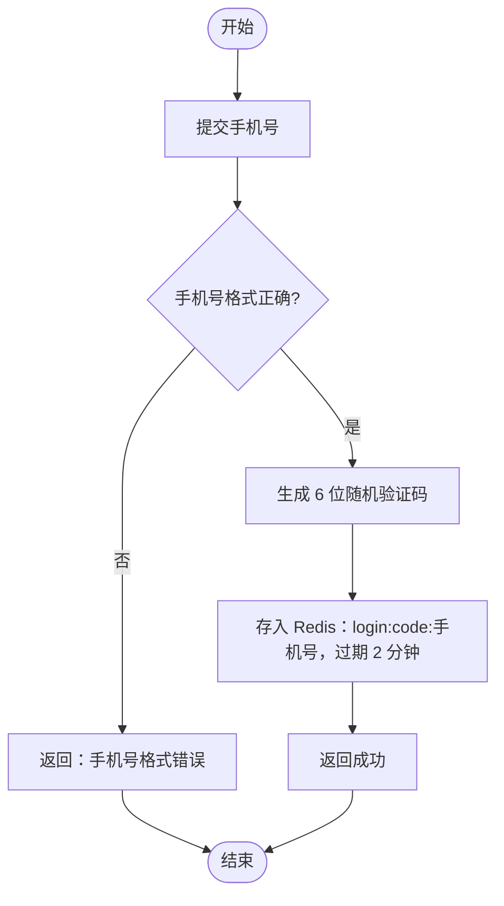
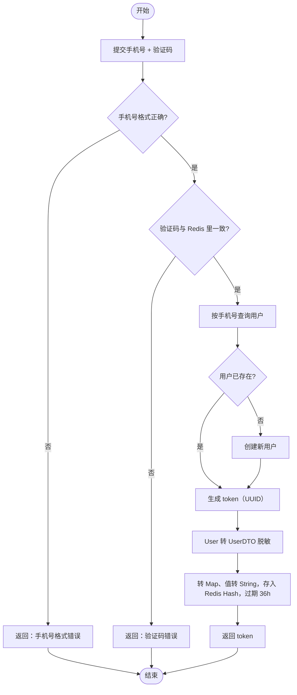
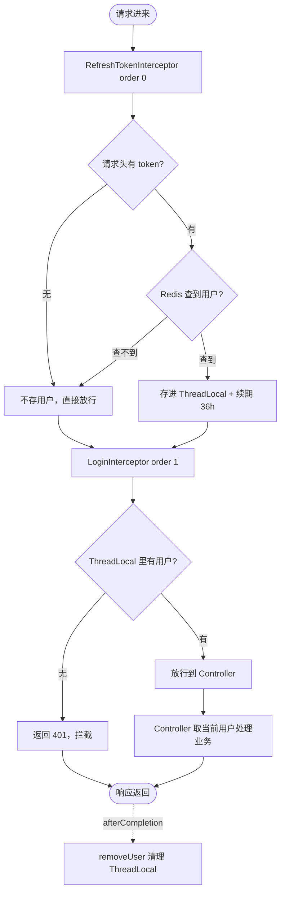

# 黑马点评 —— 登录功能学习笔记（业务层：问题 → 思路 → 解决办法）

> 本笔记聚焦「登录鉴权」这一章，主线是**业务层逻辑的演进**：
> 为什么要用 Redis 替代 Session → 如何生成并保存登录凭证 → 后续请求怎么鉴权 → 双拦截器为什么要拆开 → ThreadLocal 怎么安全清理。
> 每一节都用「**问题 → 思路 → 解决办法（真实代码）→ 逐行拆解**」推进；所有代码均取自本项目当前源文件，**存在的 bug 也如实标注**。

---

## 一、整体架构：一次登录涉及哪些文件？

```
前端 login.html                          后端
─────────                              ─────
① 发验证码  ──POST /user/code?phone=──→ UserController.sendCode()
                                              ↓
                                        UserServiceImpl.sendCode()
                                              │ 验证码存 Redis（2分钟）
                                              ↓
                                        Redis: login:code:13xxx = "123456"

② 登录      ──POST /user/login(JSON)──→ UserController.login()
                                              ↓
                                        UserServiceImpl.login()
                                              │ 校验验证码 → 查/建用户 → 生成 token
                                              │ 用户信息(UserDTO)存 Redis Hash（36h）
                                              ↓
                                        Redis: login:token:UUID = {id,nickName,icon}
                                        ←── Result.ok(token) ──
        前端 sessionStorage.setItem("token", token)

③ 后续请求  ──GET /user/me(头带 token)─→ 【双拦截器】先于 Controller 执行
                                        RefreshTokenInterceptor(order 0)：查 Redis → 存 ThreadLocal → 续期
                                              ↓
                                        LoginInterceptor(order 1)：只看 ThreadLocal 是否有用户 → 无则 401
                                              ↓
                                        UserController.me()：UserHolder.getUser() 取当前用户
                                              ↓
                                        ←── Result.ok(userDTO) ──
                                        afterCompletion：两个拦截器都 removeUser() 清理
```

**涉及文件清单：**

| 文件 | 路径 | 职责 |
|------|------|------|
| login.html / common.js | nginx/html/hmdp/ | 前端登录页 / axios 自动带 token |
| [UserController.java](../src/main/java/com/hmdp/controller/UserController.java) | com/hmdp/controller/ | 接收 HTTP 请求，转发 Service |
| [UserServiceImpl.java](../src/main/java/com/hmdp/service/impl/UserServiceImpl.java) | com/hmdp/service/impl/ | **登录核心业务逻辑** |
| [RefreshTokenInterceptor.java](../src/main/java/com/hmdp/utils/RefreshTokenInterceptor.java) | com/hmdp/utils/ | 拦截所有请求：查 Redis、存 ThreadLocal、续期 |
| [LoginInterceptor.java](../src/main/java/com/hmdp/utils/LoginInterceptor.java) | com/hmdp/utils/ | 拦截需登录接口：校验 ThreadLocal 是否有用户 |
| [MvcConfig.java](../src/main/java/com/hmdp/config/MvcConfig.java) | com/hmdp/config/ | 注册两个拦截器、配置顺序与白名单 |
| [UserHolder.java](../src/main/java/com/hmdp/utils/UserHolder.java) | com/hmdp/utils/ | ThreadLocal 存取当前用户 |
| [RedisConstants.java](../src/main/java/com/hmdp/utils/RedisConstants.java) | com/hmdp/utils/ | Redis key 前缀与过期时间常量 |
| [UserDTO.java](../src/main/java/com/hmdp/dto/UserDTO.java) | com/hmdp/dto/ | 脱敏用户对象（只留 id/昵称/头像） |
| [LoginFormDTO.java](../src/main/java/com/hmdp/dto/LoginFormDTO.java) | com/hmdp/dto/ | 登录表单参数 |
| [Result.java](../src/main/java/com/hmdp/dto/Result.java) | com/hmdp/dto/ | 统一响应格式 |

---

## 二、发送验证码（业务层）

### 2.1 问题
用户登录前先收短信验证码。验证码要**临时保存**，且要能**自动过期**、**多服务器共享**。用 Session 存不行（不共享、要手动清理）。

### 2.2 思路
验证码存 **Redis**，用手机号做 key 的一部分，设短 TTL。登录时按同样 key 取回校验。

### 2.3 解决办法（真实代码：UserServiceImpl.sendCode）

> 📁 源码：[UserServiceImpl.java](../src/main/java/com/hmdp/service/impl/UserServiceImpl.java)

**业务流程图（先看逻辑，再看代码）：**



```java
@Override
public Result sendCode(String phone, HttpSession session) {
    //1.校验手机号
    if (RegexUtils.isPhoneInvalid(phone)) {
        //2.如果不符合格式，返回错误
        return Result.fail("手机号格式错误");
    }
    //3.符合格式，生成验证码
    String code = RandomUtil.randomNumbers(6);
    //4.保存验证码到 Session
    stringRedisTemplate.opsForValue().set(LOGIN_CODE_KEY + phone, code,  LOGIN_CODE_TTL, TimeUnit.MINUTES);
    //5.发送验证码（本地演示：直接打印到控制台）
    log.debug("验证码：" + code);
    return Result.ok();
}
```

### 2.4 逐行拆解

| 代码 | 作用 / 为什么 |
|------|--------------|
| `RegexUtils.isPhoneInvalid(phone)` | 正则校验手机号，返回 true=**无效** → 直接拒绝 |
| `RandomUtil.randomNumbers(6)` | Hutool 生成 6 位纯数字验证码（短信用数字，不用 `randomString`） |
| `set(LOGIN_CODE_KEY + phone, code, LOGIN_CODE_TTL, MINUTES)` | 存 Redis，key=`login:code:手机号`，2 分钟过期。**存 Redis 而非 Session**：可自动过期 + 多服务器共享 |
| `log.debug(...)` | 本地无短信服务，打印到控制台代替 |

> ⚠️ **代码小瑕疵**：第 50 行注释写「保存验证码到 Session」，但实际是存 **Redis**（注释过时，功能没问题）。方法签名仍保留 `HttpSession session` 参数也是历史遗留，当前逻辑并没用到它。

**入口（Controller）：**
```java
@PostMapping("code")
public Result sendCode(@RequestParam("phone") String phone, HttpSession session) {
    return userService.sendCode(phone, session);
}
```
`@RequestParam("phone")` 对应前端 `axios.post("/user/code?phone=" + phone)` 的 URL 参数。

---

## 三、登录（核心业务层）

### 3.1 问题
验证码通过后，怎么「记住」这个用户已登录？后续请求如何知道是谁？传统 Session 在多服务器下不共享。

### 3.2 思路
**Token + Redis 的无状态方案**：
1. 登录成功生成一个**随机不可猜的 token**（UUID）
2. 把**脱敏后的用户信息**存进 Redis，key 用 token
3. token 返回给前端保存；后续请求带上 token，后端拿 token 去 Redis 查用户

### 3.3 解决办法（真实代码：UserServiceImpl.login）

> 📁 源码：[UserServiceImpl.java](../src/main/java/com/hmdp/service/impl/UserServiceImpl.java)

**业务流程图（先看逻辑，再看代码）：**



```java
@Override
public Result login(LoginFormDTO loginForm, HttpSession session) {
    //1.校验手机号
    String phone = loginForm.getPhone();
    if (RegexUtils.isPhoneInvalid(phone)) {
        return Result.fail("手机号格式错误");
    }
    //2.校验验证码
    String cacheCode = stringRedisTemplate.opsForValue().get(LOGIN_CODE_KEY + phone);
    if (cacheCode == null || !cacheCode.equals(loginForm.getCode())) {
        return Result.fail("验证码错误");
    }
    //3.查询用户
    User user = query().eq("phone", phone).one();
    //4.判断用户是否存在
    if (user == null) {
        //5.不存在，创建用户
        user = createUserWithPhone(phone);
    }
    String token = UUID.randomUUID().toString();
    //6.保存用户（转为 UserDTO，保护密码等敏感信息）
    UserDTO userDTO = BeanUtil.copyProperties(user, UserDTO.class);
    //7.保存用户到 Redis（id是Long类型，需转为String才能存入StringRedisTemplate）
    Map<String, Object> userMap = BeanUtil.beanToMap(userDTO);
    userMap.replaceAll((k, v) -> v != null ? v.toString() : null);
    stringRedisTemplate.opsForHash().putAll(LOGIN_USER_KEY + token, userMap);
    stringRedisTemplate.expire(LOGIN_USER_KEY + token, LOGIN_USER_TTL, TimeUnit.MINUTES);
    return Result.ok(token);
}
```

### 3.4 逐行拆解

| 步骤 | 代码 | 作用 / 为什么 |
|------|------|--------------|
| ① | `RegexUtils.isPhoneInvalid` | 手机号格式校验，和发验证码同一套规则 |
| ② | `get(LOGIN_CODE_KEY + phone)` | 用**同样的 key** 取回验证码。`cacheCode==null`（过期/没发）或 `!equals`（输错）→ 拒绝 |
| ③ | `query().eq("phone", phone).one()` | MyBatis-Plus 链式查询：`SELECT * FROM tb_user WHERE phone=? LIMIT 1` |
| ④⑤ | `createUserWithPhone(phone)` | 用户不存在就自动注册（随机昵称、插库） |
| — | `UUID.randomUUID().toString()` | 生成 token。用 Hutool 的 UUID，**随机不可猜、全局唯一**，别人无法伪造 |
| ⑥ | `BeanUtil.copyProperties(user, UserDTO.class)` | **脱敏**：`User` 含 password/phone，不能存 Redis/返前端；`UserDTO` 只有 id/nickName/icon |
| ⑦ | `BeanUtil.beanToMap(userDTO)` | 对象转 Map，准备存 Hash |
| ⑦ | `userMap.replaceAll((k,v)-> v!=null? v.toString():null)` | **关键**：`StringRedisTemplate` 的 Hash value 必须是 String，而 `id` 是 Long，不转会序列化报错 |
| ⑦ | `opsForHash().putAll(LOGIN_USER_KEY+token, userMap)` | 以 **Hash** 存：key=`login:token:UUID`。**用 Hash 不用 String**：可单独改某字段（如昵称），无需整体序列化 |
| ⑦ | `expire(..., LOGIN_USER_TTL, MINUTES)` | 36 小时过期。注意单位 MINUTES，`LOGIN_USER_TTL=36*60` |
| — | `return Result.ok(token)` | token 返前端，前端 `sessionStorage` 保存 |

> ⚠️ **单位一致性**：登录存 token 用 `MINUTES`，后面拦截器续期也必须用 `MINUTES`，否则有效期会错乱（这是踩过的坑，见 `RefreshTokenInterceptor` 第 40 行注释）。

**注册新用户（私有方法）：**
```java
private User createUserWithPhone(String phone) {
    User user = new User();
    user.setPhone(phone);
    user.setNickName(USER_NICK_NAME_PREFIX + RandomUtil.randomString(10));
    save(user);
    return user;
}
```

---

## 四、后续请求鉴权：双拦截器架构（本章重点）

### 4.1 问题
登录成功后，前端每次请求带上 token，后端要校验。但**单拦截器方案有缺陷**：
- 若拦截器只在「需要登录」的接口上生效，那么用户浏览**首页/商铺详情**（不需要登录）时 token **不会续期**
- 结果：用户明明一直在逛，36 小时后 token 还是过期了，被迫重新登录

### 4.2 思路
**拆成两个拦截器，各司其职：**

| 拦截器 | 拦截范围 | 职责 | 是否拦截请求 |
|--------|---------|------|-------------|
| `RefreshTokenInterceptor` | `/**`（所有请求） | 查 Redis、存 ThreadLocal、**续期** | ❌ 永远放行 |
| `LoginInterceptor` | 需登录的接口 | 校验 ThreadLocal 是否有用户 | ✅ 无用户则 401 |

分工后：浏览类请求也会经过 `RefreshTokenInterceptor` → token 一直被续期；只有真正需要登录的接口才由 `LoginInterceptor` 把关。

### 4.3 解决办法之一：RefreshTokenInterceptor（负责「存」和「续期」）

> 📁 源码：[RefreshTokenInterceptor.java](../src/main/java/com/hmdp/utils/RefreshTokenInterceptor.java)

**鉴权总流程图（两个拦截器合起来看，本章重点）：**



> ⚠️ 上图按**正确设计意图**画（`getUser()==null` 才 401）；源码 `LoginInterceptor` 已按此修正（原 `!=` 逻辑反转的 bug 已修）。

```java
public class RefreshTokenInterceptor implements HandlerInterceptor {
    private StringRedisTemplate stringRedisTemplate;

    public RefreshTokenInterceptor(StringRedisTemplate stringRedisTemplate) {
        this.stringRedisTemplate = stringRedisTemplate;
    }

    @Override
    public boolean preHandle(HttpServletRequest request, HttpServletResponse response, Object handler) throws Exception {
        //1.获取token
        String token = request.getHeader("Authorization");
        if(StrUtil.isBlank(token)) {
            return true;
        }
        //3.获取用户信息
        String key = RedisConstants.LOGIN_USER_KEY + token;
        //4.判断用户信息是否存在
        Map<Object, Object> userMap = stringRedisTemplate.opsForHash().entries(key);
        if (userMap.isEmpty()) {
            return true;
        }
        //5.将用户信息保存到ThreadLocal
        UserDTO userDTO = BeanUtil.fillBeanWithMap(userMap, new UserDTO(), false);
        UserHolder.saveUser(userDTO);
        //6.刷新token有效期（单位要与登录时一致：MINUTES）
        stringRedisTemplate.expire(key, RedisConstants.LOGIN_USER_TTL, TimeUnit.MINUTES);
        return true;
    }

    @Override
    public void afterCompletion(HttpServletRequest request, HttpServletResponse response, Object handler, @Nullable Exception ex) throws Exception {
        UserHolder.removeUser();
    }
}
```

| 步骤 | 代码 | 逻辑意图 |
|------|------|---------|
| ① | `getHeader("Authorization")` | 取 token，对应前端 `config.headers['authorization']=token` |
| ① | `isBlank → return true` | 没 token 也**放行**（它不负责拦截，浏览类请求本就没 token） |
| ④ | `opsForHash().entries(key)` | 查 Redis Hash。空=token 无效/过期 → 也放行（不拦截是它的职责边界） |
| ⑤ | `fillBeanWithMap(...)` + `saveUser` | 把 Map 反向填充成 UserDTO，存进 **ThreadLocal** 供后续使用 |
| ⑥ | `expire(key, TTL, MINUTES)` | **滑动续期**：每次访问重置 36 小时。这是解决 4.1 问题的关键 |
| — | 永远 `return true` | RefreshTokenInterceptor **从不拦截**任何请求 |

### 4.4 解决办法之二：LoginInterceptor（负责「查」和「拦截」）

> 📁 源码：[LoginInterceptor.java](../src/main/java/com/hmdp/utils/LoginInterceptor.java)

```java
public class LoginInterceptor implements HandlerInterceptor {

    @Override
    public boolean preHandle(HttpServletRequest request, HttpServletResponse response, Object handler) throws Exception {
       if(UserHolder.getUser() == null){       // ✅ 未登录（null）才拦截
           response.setStatus(401);
           return false;
       }
        return true;                            // ✅ 已登录才放行
    }

    @Override
    public void afterCompletion(HttpServletRequest request, HttpServletResponse response, Object handler, @Nullable Exception ex) throws Exception {
        UserHolder.removeUser();
    }
}
```

**设计意图（正确版应该是这样）：** LoginInterceptor **不再查 Redis**（Redis 的活已由 RefreshTokenInterceptor 干完并存进 ThreadLocal），它只需看 `UserHolder.getUser()` 是否为 null：
- 为 null（没登录）→ 401 拦截
- 不为 null（已登录）→ 放行

### 4.5 已修复的两个 Bug（复习时对照）

> 📁 源码：[LoginInterceptor.java](../src/main/java/com/hmdp/utils/LoginInterceptor.java)（均已修复）

| Bug | 曾经的错写法 | 后果 | 现已修正为 |
|-----|------|------|---------|
| **判断逻辑反转** | `if(UserHolder.getUser() != null)` 就返回 401 | 已登录被拒、未登录反而放行，鉴权完全失效 | `if(UserHolder.getUser() == null)` ✅ |
| **构造函数无效自赋值** | `this.stringRedisTemplate = stringRedisTemplate;`（字段赋给自己） | 本类根本用不到它（改由 UserHolder 取用户），属误导性死代码 | 已删除该字段与无参构造 ✅ |

> 📌 这两个是当初手敲时真实踩过的坑，现已修正。保留记录是为了复习时明白「为什么必须是 `== null`」。

### 4.6 执行顺序（MvcConfig 里 order 0 → 1）

```
请求进来
   ↓
RefreshTokenInterceptor.preHandle (order 0)  ← 取 token → 查 Redis → UserHolder.saveUser 存 → 续期 → return true
   ↓                                            （token 为空 / Redis 查不到 → 不存，仍 return true 放行）
LoginInterceptor.preHandle (order 1)         ← 不碰 Redis，只看 UserHolder.getUser()
   ↓                                            null → 401 拒绝；非 null → 放行
Controller 业务                               ← UserHolder.getUser() 取当前用户
   ↓
响应返回后
   ↓
afterCompletion                              ← ★ 两个拦截器都会被调用 removeUser() 清理 ThreadLocal
```

---

## 五、ThreadLocal 的存与清理（UserHolder）

### 5.1 问题
拦截器查到了用户，但 Controller 方法签名里没有 user 参数，怎么把用户传过去？而且用**线程池**处理请求，若不清理会导致**数据串号 + 内存泄漏**。

### 5.2 思路
用 **ThreadLocal**：线程级全局变量。同一请求的拦截器和 Controller 在同一线程，天然共享；不同请求=不同线程=互不干扰。用完必须在 `afterCompletion` 清理。

### 5.3 解决办法（真实代码：UserHolder）

> 📁 源码：[UserHolder.java](../src/main/java/com/hmdp/utils/UserHolder.java)

```java
public class UserHolder {
    private static final ThreadLocal<UserDTO> tl = new ThreadLocal<>();
    public static void saveUser(UserDTO user){ tl.set(user); }
    public static UserDTO getUser(){ return tl.get(); }
    public static void removeUser(){ tl.remove(); }
}
```

**使用示例（真实代码：UserController.me）：**
```java
@GetMapping("/me")
public Result me(){
    UserDTO user = UserHolder.getUser();   // 从 ThreadLocal 取当前登录用户
    return Result.ok(user);
}
```

### 5.4 为什么必须清理？

`tl.remove()` = 从**当前线程**的 ThreadLocalMap 里删掉这个 entry：

```
Tomcat线程-1                     Tomcat线程-2
└─ threadLocals (Map)            └─ threadLocals (Map)
   └─ key: tl → UserDTO(1010)       └─ key: tl → UserDTO(2020)
```

不清理的后果（线程池复用线程）：
```
第1次请求：线程-7 存了张三 → afterCompletion 没删 → 线程-7 回池，Map 残留张三
第2次请求：线程-7 处理李四，李四没带 token（不存不覆盖）
        → 业务 UserHolder.getUser() 取到残留的张三！ ← 数据串号
```
两大危害：① **安全事故**（用户 A 看到用户 B 信息）② **内存泄漏**（value 是强引用，不 remove 无法回收）。

> ✅ 本项目**两个拦截器的 `afterCompletion` 都调了 `removeUser()`**。因为 `HandlerInterceptor` 保证：无论请求成功、抛异常、还是被 `preHandle` 拦下，已执行过 preHandle 的拦截器的 afterCompletion 都会被调用，所以清理不会遗漏（调两次也无害，第二次已无数据）。

---

## 六、MvcConfig：注册拦截器（真实代码）

### 6.1 问题
两个拦截器都**不是 Spring Bean**（没有 `@Component`），Spring 不会自动注册；且需要控制**执行顺序**和**白名单**。

### 6.2 思路
用 `WebMvcConfigurer.addInterceptors` 手动 `new` 拦截器并注册，用 `order()` 定顺序、`excludePathPatterns()` 配白名单。

### 6.3 解决办法

> 📁 源码：[MvcConfig.java](../src/main/java/com/hmdp/config/MvcConfig.java)

```java
@Configuration
public class MvcConfig implements WebMvcConfigurer {
    @Resource
    private StringRedisTemplate stringRedisTemplate;

    @Override
    public void addInterceptors(InterceptorRegistry registry) {
        // 登录拦截器
        registry.addInterceptor(new LoginInterceptor())
                .addPathPatterns("/**")
                .excludePathPatterns(
                        "/user/login", "/user/code", "/blog/hot",
                        "/shop-type/", "/shop/**", "/voucher/**"
                ).order(1);
        // 刷新令牌拦截器
        registry.addInterceptor(new RefreshTokenInterceptor(stringRedisTemplate))
                .addPathPatterns("/**").order(0);
    }
}
```

| 代码 | 为什么 |
|------|--------|
| `@Configuration` | **必须有**，否则这个配置类不生效、拦截器根本不注册（踩过的坑） |
| `new RefreshTokenInterceptor(stringRedisTemplate)` | 它要查 Redis，所以构造时传入 template |
| `new LoginInterceptor()` | 它只读 ThreadLocal，不需要 template（所以用无参构造） |
| `.order(0)` / `.order(1)` | 数字小先执行：刷新令牌(0) 先跑并填好 ThreadLocal，登录校验(1) 后跑读取它 |
| `.addPathPatterns("/**")` | 刷新令牌拦截**所有**请求（保证浏览也续期） |
| `.excludePathPatterns(...)` | 登录拦截器的**白名单**：登录、验证码、浏览类接口免登录 |

---

## 七、常量与 DTO（真实代码摘录）

### 7.1 RedisConstants

> 📁 源码：[RedisConstants.java](../src/main/java/com/hmdp/utils/RedisConstants.java)
```java
public static final String LOGIN_CODE_KEY = "login:code:";   // 验证码 key 前缀
public static final Long LOGIN_CODE_TTL = 2L;                // 验证码过期：2分钟
public static final String LOGIN_USER_KEY = "login:token:";  // 用户 token key 前缀
public static final Long LOGIN_USER_TTL = 36*60L;            // 用户过期：36小时（分钟）
```
抽常量的好处：key/TTL 在 sendCode、login、拦截器多处使用，统一管理、改一处全局生效。

Redis 中实际数据示例：
```
login:code:13xxx      → "482913"                             (String, 2分钟)
login:token:550e84... → {id:"1010", nickName:"用户xxx", icon:"a.png"}  (Hash, 36小时)
```

### 7.2 UserDTO（脱敏）

> 📁 源码：[UserDTO.java](../src/main/java/com/hmdp/dto/UserDTO.java)
只含 `id`、`nickName`、`icon` 三个字段——**面具**，隐藏 password/phone 等敏感信息，可安全存 Redis、返前端。

### 7.3 Result（统一响应）

> 📁 源码：[Result.java](../src/main/java/com/hmdp/dto/Result.java)
```java
public static Result ok(){ return new Result(true, null, null, null); }
public static Result ok(Object data){ return new Result(true, null, data, null); }
public static Result fail(String errorMsg){ return new Result(false, errorMsg, null, null); }
```
静态工厂方法简化调用；前端靠 `success` 字段统一判断成败。

---

## 八、前端配合（了解）

### 8.1 login.html：保存 token
```javascript
axios.post("/user/login", this.form).then(({data}) => {
    if(data){ sessionStorage.setItem("token", data); }   // data 就是 token
    location.href = "/index.html";
});
```
`sessionStorage` 而非 `localStorage`：关标签页即清空（关浏览器=退出登录）。

### 8.2 common.js：请求自动带 token
```javascript
let token = sessionStorage.getItem("token");
axios.interceptors.request.use(config => {
    if(token) config.headers['authorization'] = token;   // 放进请求头
    return config;
});
```
axios 请求拦截器：每个请求发出前自动带上 token，业务代码无需手动传，对应后端 `getHeader("Authorization")`。

---

## 九、常见问题 FAQ

### Q1: 为什么验证码/用户信息存 Redis 不存 Session？
Session 在服务器内存，多机部署不共享；Redis 独立服务全共享，且支持 TTL 自动过期。

### Q2: token 为什么用 UUID 而不是用户 ID？
用户 ID 可猜测（1001、1002…）易伪造；UUID 是随机全局唯一，无法猜中。

### Q3: `userMap.replaceAll((k,v)->v.toString())` 干嘛的？
`StringRedisTemplate` 的 Hash value 必须是 String，而 `id` 是 Long，不转会序列化报错。

### Q4: 为什么要两个拦截器，一个不行吗？
单拦截器只在需登录接口生效，浏览类请求不续期，导致用户一直在逛也会 36h 后掉线。双拦截器让 RefreshTokenInterceptor 拦所有请求负责续期，LoginInterceptor 只管需登录接口。

### Q5: LoginInterceptor 为什么不查 Redis 了？
Redis 查询已由 order 0 的 RefreshTokenInterceptor 完成并存进 ThreadLocal，LoginInterceptor 只需读 ThreadLocal，避免重复查 Redis。

### Q6: ThreadLocal 不清理会怎样？
线程池复用线程 → 数据串号（看到别人信息）+ 内存泄漏。靠两个拦截器的 afterCompletion `removeUser()` 保证清理。

### Q7: 当前 LoginInterceptor 有什么问题？
① `if(getUser()!=null)` 逻辑反了，应 `==null`，否则已登录被拒、未登录放行；② 构造函数 `this.x=x` 无效自赋值（无害但是死代码）。

---

## 十、一句话总结

| 类 | 一句话 |
|----|--------|
| UserController | 接收 HTTP 请求，转发给 Service |
| UserServiceImpl | 登录核心：校验验证码 → 查/建用户 → 生成 token → 脱敏存 Redis Hash |
| RefreshTokenInterceptor | 「存+续期」：拦所有请求，查 Redis、存 ThreadLocal、滑动续期，从不拦截 |
| LoginInterceptor | 「查+拦截」：只看 ThreadLocal 有无用户，无则 401（逻辑已修正为 `== null`） |
| MvcConfig | 注册表：`@Configuration` + order(0/1) + 白名单 |
| UserHolder | 传话筒：ThreadLocal 在拦截器与 Controller 间传当前用户 |
| RedisConstants | 字典：所有 key 前缀与 TTL |
| UserDTO | 面具：只暴露 id/昵称/头像 |
| Result | 信封：统一成功/失败响应 |
| common.js | 快递员：每个请求自动带 token |

---

## 十一、复习速记卡（背这几句就够）

1. **发验证码**：校验手机号 → `randomNumbers(6)` → 存 `login:code:手机号`（2分钟）
2. **登录**：校验验证码 → `query().eq("phone").one()` 查/建用户 → `UUID` 生成 token → `copyProperties` 转 UserDTO 脱敏 → `beanToMap`+`replaceAll` 转 String → `opsForHash().putAll` 存 `login:token:UUID`（36h）→ 返回 token
3. **鉴权分工**：RefreshTokenInterceptor(order0) 查 Redis+存 ThreadLocal+续期；LoginInterceptor(order1) 只读 ThreadLocal 判空拦截
4. **为什么双拦截器**：让浏览类请求也续期，避免用户在线却掉线
5. **ThreadLocal**：saveUser 存 / getUser 取 / removeUser 清；两个拦截器 afterCompletion 都清理，防串号+内存泄漏
6. **MvcConfig**：必须 `@Configuration`；拦截器非 Bean 要手动 new；order 小的先执行
7. **单位一致**：登录与续期都用 `MINUTES`
8. **已修 bug**：LoginInterceptor 判断条件曾写反（`!=null`），现已改为 `==null`（未登录才 401）
